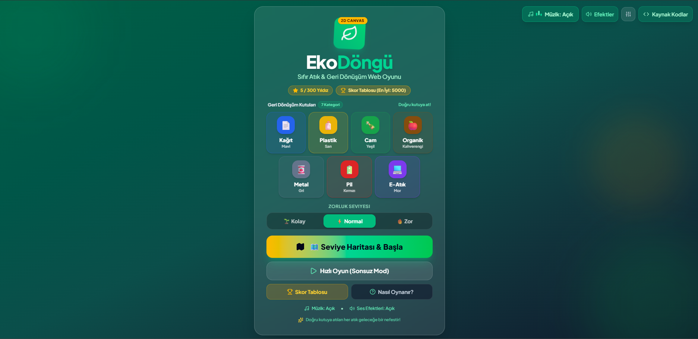
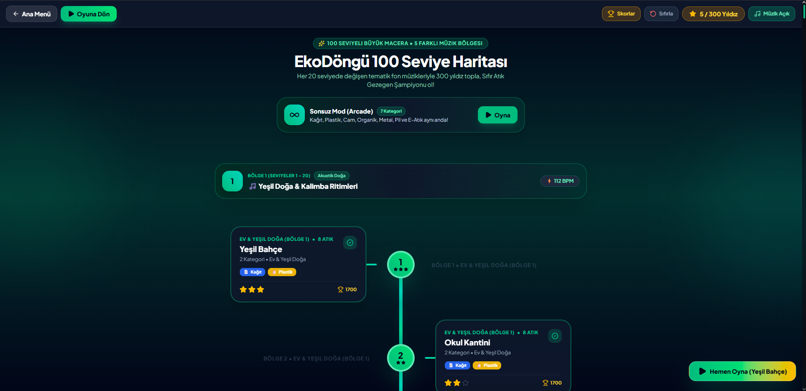
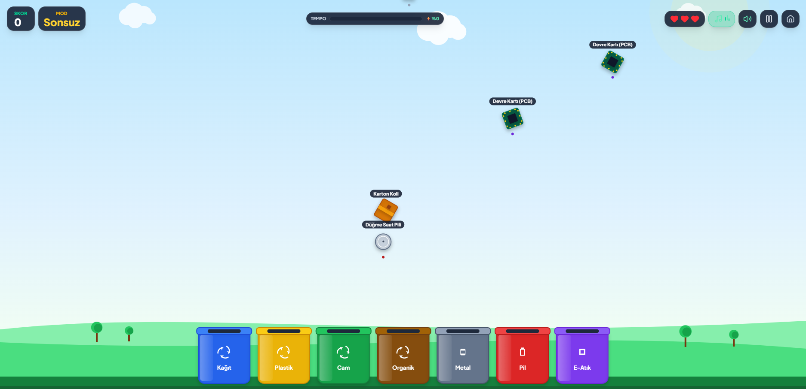

# 🌿 EkoDöngü - Sıfır Atık (Zero Waste) 2D Web Oyunu

[](https://react.dev/)
[](https://www.typescriptlang.org/)
[](https://developer.mozilla.org/en-US/docs/Web/API/Canvas_API)
[](https://tailwindcss.com/)
[](https://developer.mozilla.org/en-US/docs/Web/API/Web_Audio_API)
[](#)

> **EkoDöngü**, çevre bilincini ve geri dönüşüm kültürünü eğlenceli, dinamik ve eğitici bir oyun deneyimiyle sunan **2D HTML5 Canvas web oyunudur**. Oyuncular gökyüzünden süzülen evsel ve endüstriyel atıkları doğru geri dönüşüm kutularına fırlatarak veya sürükleyip bırakarak doğayı kurtarır, kombolar yapar ve 10 farklı seviyede yıldızlar toplayarak Sıfır Atık Şampiyonu olur!

---

## 🌐 Canlı Oyun Bağlantısı (Live Demo)

Oyunu tarayıcınızda doğrudan hemen oynamak için aşağıdaki bağlantıya tıklayın:

👉 **[EkoDöngü Canlı Oyunu Başlat (Tıklayın)](https://ais-pre-wum6okfqvguiwnjhdfh7p3-524291745461.europe-west3.run.app)**  
*(Kendi alan adınıza veya sunucunuza yayınladığınızda bağlantıyı bu alandan güncelleyebilirsiniz.)*

---

## 📸 Oyun İçi Görüntüler (Screenshots)

*Aşağıdaki alanlara oyunun ekran görüntülerini ekleyebilirsiniz:*

### 1. Ana Giriş Menüsü & 7 Kategori Önizleme
<a href=""></a>

*Zorluk seçimi (Kolay / Normal / Zor), ses/müzik kontrolleri ve 7 geri dönüşüm kutusu.*

### 2. Seviye Haritası (100 Aşamalı Yolculuk & Scroll Bar)
<a href=""></a>

*100 farklı bölge, 300 yıldız ilerlemesi, özel yeşil kaydırma çubuğu ve yeni açılan seviyeye otomatik yumuşak kayma (`smooth scroll`).*

### 3. Oyun İçi Oynanış (Canvas Game Loop & HUD)
<a href=""></a>

*Atıkların havada süzülmesi, dinamik geri dönüşüm kutuları, kombo çarpanı ve eğitici bilgi balonları.*

---

## 🎯 Oyunun Amacı ve Misyonu

Gezegenimiz her yıl milyarlarca ton geri dönüştürülebilir atığın yanlış yönetimi nedeniyle kirlenmektedir. **EkoDöngü** oyununun amacı:
- Atıkların çöp olmadığını, doğru ayrıştırıldığında **değerli bir hammaddeye** dönüştüğünü göstermek.
- Hangi atığın hangi renkli geri dönüşüm kutusuna atılması gerektiği refleksini kazandırmak.
- Her başarılı ayrıştırmada oyuncuya gerçek bilimsel tasarruf verilerini (kurtarılan ağaçlar, temiz su, enerji tasarrufu) öğretmektir.

---

## 🎮 Oynanış & Temel Mekanikler

### 🕹️ Kontroller
* **Masaüstü (Bilgisayar):** Fare sol tuşu ile düşen atıkları tıklayıp basılı tutarak sürükleyin ve doğru kutunun içine bırakın.
* **Mobil & Tablet (Dokunmatik Ekran):** Parmakla atıklara dokunarak havada yakalayın ve kutulara yönlendirin. `touch-action: none` optimizasyonu sayesinde sayfa kayması olmadan kesintisiz oynanır.

### 🔥 Kombo Çarpan Sistemi
* Peş peşe hata yapmadan doğru kutuya atılan her atık kombo sayacını doldurur:
  * **2x Kombo:** +200 Puan
  * **3x Kombo:** +300 Puan
  * **4x Kombo:** +400 Puan
  * **5x (Maksimum Kombo):** +500 Puan ve özel görsel efektler!
* Yanlış kutuya atıldığında veya atık yere düştüğünde kombo sıfırlanır.

### ❤️ Can ve Puan Sistemi
* Oyuna **3 Kalp Can** ile başlanır.
* Bir atık yanlış kutuya atılırsa veya yer platformuna düşüp ziyan olursa **1 can kaybedilir**, ekran sarsılır (`screen shake`) ve hata buzzer sesi çalar.
* 3 can tükendiğinde oyun biter ve detaylı başarı/istatistik ekranı görüntülenir.

### ⚙️ Zorluk Seviyeleri
* **🌱 Kolay:** Atıklar daha yavaş süzülür; başlangıç ve çocuklar için idealdir.
* **⚡ Normal:** Standart dengeli arcade temposu.
* **🔥 Zor:** Atıklar daha hızlı düşer, ekran üzerindeki aynı andaki atık sayısı artar.

---

## ♻️ 7 Geri Dönüşüm Kategorisi ve Renk Standartları

Oyunda uluslararası sıfır atık standartlarına uygun **7 farklı atık türü** bulunmaktadır:

| Kategori | Renk & Kutu | Temsili Atıklar | Eğitici Çevre İpucu |
| :--- | :--- | :--- | :--- |
| **📄 Kağıt & Karton** | 🟦 **Mavi Kutu** | Eski Gazete, Karton Koli, Defter, Yumurta Kolisi | 1 ton kağıt geri dönüştürülünce 17 yetişkin ağaç ve 26.500 L su kurtulur! |
| **🧴 Plastik** | 🟨 **Sarı Kutu** | PET Su Şişesi, Deterjan Kutusu, Yoğurt Kabı, Şampuan Şişesi | Plastiklerin doğada yok olması 450-1000 yıl sürer; dönüştürülünce petrol tasarrufu sağlar. |
| **🍾 Cam** | 🟩 **Yeşil Kutu** | Cam Meşrubat Şişesi, Reçel Kavanozu, Soda Şişesi, Zeytinyağı Şişesi | Cam %100 saflıkla ve kalitesini hiç kaybetmeden sonsuz kez eritilip geri dönüştürülür. |
| **🍎 Organik (Kompost)** | 🟫 **Kahverengi Kutu** | Elma Koçanı, Muz Kabuğu, Çürük Domates, Yumurta Kabukları, Çay Posası | Kompost yapılarak toprağa kimyasal gübre yerine en zengin doğal besin sağlanır. |
| **🥫 Metal & Alüminyum** | ⬜ **Gri Kutu** | Teneke İçecek Kutusu, Konserve Kutusu, Metal Şişe Kapakları | 1 alüminyum kutunun geri dönüşümü, sıfırdan üretimine göre %95 daha az enerji harcar. |
| **🔋 Pil** | 🟥 **Kırmızı Kutu** | Kalem Pil (AA), 9V Blok Pil, Düğme Saat Pili | 1 küçük pil toprağa karıştığında 800.000 litre içme suyunu ve 4 m² toprağı zehirler! |
| **💻 Elektronik (E-Atık)** | 🟪 **Mor Kutu** | Eski Akıllı Telefon, Bozuk Fare, Devre Kartı (PCB), USB Bellek | 1 ton akıllı telefondan, 1 ton altın cevherinden 100 kat daha fazla saf altın elde edilir! |

---

## 🗺️ 10 Seviyeli Macera Haritası & Sonsuz Mod

### Seviye Haritası Özellikleri:
1. **Dikey Yol (Spine) & Kart Ayrımı:** Seviye kartları ile ortadaki yol çizgisi asla üst üste binmez; kartlar yolun sağına ve soluna şık bağlantı köprüleriyle konumlandırılmıştır.
2. **Özel Kaydırma Çubuğu (`Scrollbar`):** Haritanın sağ tarafında zümrüt yeşili neon efektli özel kaydırma çubuğu yer alır; tüm 10 seviye arasında yukarı-aşağı rahatça gezilebilir.
3. **Yumuşak Aşağı Kayma Animasyonu (`Auto-Scroll`):** Harita açıldığında veya seviye kazanıldığında ekran otomatik olarak en son açılan seviyeye pürüzsüzce odaklanır.
4. **Oyuna Dön Butonları:** Haritanın üst başlığında "Oyuna Dön" butonu ve sağ altta her an tıklanabilir yüzen "Hemen Oyna" aksiyon butonu mevcuttur.
5. **Yıldız Puanlama:** Puan barajlarına göre her seviyede 1, 2 veya 3 Yıldız (⭐ Toplam 30 Yıldız) kazanılır ve veriler `localStorage` ile tarayıcıda saklanır.

### Seviyeler:
* **Seviye 1: Yeşil Bahçe** (Kağıt, Plastik)
* **Seviye 2: Okul Bahçesi** (Kağıt, Plastik, Cam)
* **Seviye 3: Eko Park & Piknik** (Kağıt, Plastik, Cam, Organik)
* **Seviye 4: Mavi Sahil Kıyısı** (Plastik, Cam, Metal, Organik)
* **Seviye 5: Geri Dönüşüm Tesisi** (Kağıt, Metal, Pil, Plastik)
* **Seviye 6: Teknoloji Vadisi** (Elektronik, Pil, Metal, Plastik)
* **Seviye 7: Eko Metropol** (Kağıt, Plastik, Cam, Metal, Pil)
* **Seviye 8: Akıllı Bilişim Şehri** (Elektronik, Pil, Metal, Cam, Plastik)
* **Seviye 9: Eko Yörünge İstasyonu** (Pil, Elektronik, Metal, Cam)
* **Seviye 10: Sıfır Atık Gezegen Zirvesi** (Tüm 7 Kategori Aktif Final!)

### ⚡ Hızlı Oyun (Sonsuz Mod):
* **Tüm 7 Atık Türü ve 7 Kutu** aynı anda devrededir.
* Can bitene kadar devam eder.
* Her 10 başarılı ayrıştırmada arcade tempo artar, seviye atlama melodisi çalar.

---

## 🎵 Ses ve Müzik Sistemi

* **Telifsiz Eko Ritim BGM:** Arka planda çalan neşeli, temaya uygun döngüsel müzik.
* **Müzik Aç/Kapat Butonu:** Hareketli ekolayzır animasyonlu özel müzik butonu ile anında sessize alınabilir.
* **Ses Seviyesi Ayarı:** Müzik volümü %0 ile %100 arasında hassas ayarlanabilir.
* **Ses Efektleri (SFX):**
  * *Başarı (Ding Chime):* Doğru kutuya atıldığında.
  * *Hata (Buzzer/Error):* Yanlış kutuya atıldığında veya atık yere düştüğünde.
  * *Yakalama (Grab):* Atığa tıklandığında/dokunulduğunda.
  * *Yıldız Fanfarı:* Seviye bitiş ekranında kazanılan her bir yıldız için sıralı melodi.
* **Çift Katmanlı Mimari:** Harici ses dosyalarına ek olarak **Web Audio API Prosedürel Osilatör Sentezleyici** entegredir. Harici ses dosyası yüklenemese bile tüm ses efektleri tarayıcı tarafından sıfır gecikmeyle anında üretilir.

---

## 💻 Teknik Mimari ve Kullanılan Teknolojiler

* **Frontend Framework:** React 19 (Fonksiyonel bileşenler, özel hook'lar)
* **Tip Güvenliği:** TypeScript (Strict tip tanımları, enums ve interface yapıları)
* **Grafik Motoru:** HTML5 Canvas 2D API (`requestAnimationFrame` 60 FPS optimize döngü)
* **Ekran Uyumluluğu:** `window.devicePixelRatio` ile Retina / High-DPI ekranlarda sıfır pikselleşme
* **Stil & Arayüz:** Tailwind CSS v4 (Modern koyu zümrüt cam morfolojisi - Glassmorphism)
* **İkon Kütüphanesi:** Lucide React
* **Animasyonlar:** Motion & CSS Hardware Accelerated Keyframes
* **Dokunmatik Motoru:** `pointer / touch events` (`changedTouches` ve `touch-action: none` desteği)
* **Kalıcı Depolama:** Web Storage (`localStorage`) ile skor ve seviye ilerlemesi saklama
* **Sunucu & Derleme:** Vite 8 + Express (Node.js)

---

## 📱 Responsive & Cihaz Desteği

Oyun her ekran boyutuna göre kendini otomatik ölçekler:
- 📱 **Akıllı Telefonlar (iOS & Android):** Dinamik kutu boyutlandırma, geniş dokunma yarıçapı (+24px parmak toleransı).
- 📟 **Tabletler (iPad, Android Tabletler):** Geniş oyun alanı, optimize edilmiş arayüz butonları.
- 💻 **Masaüstü & Geniş Ekranlar:** Tam ekran 60 FPS akıcı deneyim ve klavye/fare hassasiyeti.

---

## 🛠️ Kurulum ve Yerel Geliştirme

Projeyi kendi bilgisayarınızda çalıştırmak için aşağıdaki adımları izleyin:

```bash
# 1. Proje dizinine gidin
cd ekodongu

# 2. Bağımlılıkları yükleyin
npm install

# 3. Geliştirme sunucusunu başlatın
npm run dev
```

Tarayıcınızda `http://localhost:3000` adresini açarak oyunu hemen oynayabilirsiniz.

```bash
# Üretim (Production) derlemesi almak için:
npm run build
```

---

## 📦 Proje Dizin Yapısı

```
├── public/                 # Statik medya ve görseller
├── src/
│   ├── components/         # React arayüz bileşenleri
│   │   ├── StartScreen.tsx     # Başlangıç menüsü ve kategori önizleme
│   │   ├── LevelMap.tsx        # 10 Seviyeli harita, scrollbar ve yol sistemi
│   │   ├── GameCanvas.tsx      # Canvas 2D oyun döngüsü ve fizik motoru
│   │   ├── GameHUD.tsx         # Skor, can, kombo ve kontrol paneli
│   │   ├── LevelWinModal.tsx   # Seviye tamamlama ve yıldız animasyonu
│   │   ├── GameOverModal.tsx   # Oyun bitti ve istatistik ekranı
│   │   ├── HowToPlayModal.tsx  # Sıfır atık rehberi ve oynanış bilgisi
│   │   └── CodeViewerModal.tsx # Standalone saf kod dışa aktarma penceresi
│   ├── types/
│   │   └── game.ts             # Oyun verisi tip tanımları ve interface'ler
│   ├── utils/
│   │   ├── audio.ts            # Web Audio API sentezleyici & BGM yöneticisi
│   │   ├── canvasRenderer.ts   # 2D Canvas çizim ve parçacık motoru
│   │   └── educationalData.ts  # 7 Kategori, 10 seviye ve çevre ipuçları
│   ├── App.tsx             # Ana uygulama durum yöneticisi
│   ├── index.css           # Tailwind CSS ve özel kaydırma çubuğu stilleri
│   └── main.tsx            # React kök montaj noktası
├── index.html              # HTML5 giriş şablonu ve SEO meta etiketleri
├── package.json            # Proje bağımlılıkları ve npm betikleri
├── tsconfig.json           # TypeScript derleme ayarları
└── README.md               # Kapsamlı proje dökümantasyonu
```

---

## 📄 Lisans

Bu proje eğitim ve çevre bilincini yaygınlaştırmak amacıyla geliştirilmiştir. Açık kaynak kodlu olup tüm hakları saklıdır.

*Doğayı korumak için bugün doğru kutuya bir atık atın! 🌍💚*
